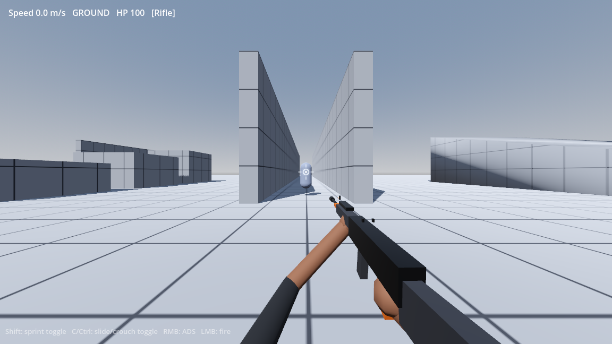

# Titan Movement FPS (Godot 4)

A greybox, mechanics-first Titanfall-inspired FPS. Everything is procedural
(primitive meshes, generated blood splats, synthesized hitmarker blips) so the
movement, gunplay, AI and gore loops can be tuned before the art pass.

Open `project.godot` in Godot 4.7+ (Forward+) and press **F5**.

## Controls

| Input | Action |
|---|---|
| **WASD** | Move |
| **Shift** | **Toggle sprint** (off by default). Pressing it while crouched/sliding instantly cancels the crouch and transitions to sprint. Sprint switches off the moment the movement keys are released. |
| **C / Ctrl** | **Toggle crouch**; if you are moving fast it becomes a **slide**. Press again to stand/end the slide. |
| **Space** | Jump / double jump / wall jump. Hold on the ground to auto-hop. |
| **Mouse** | Look |
| **LMB** | Fire the automatic rifle (physical projectiles) |
| **RMB (hold)** | Aim down sights — zooms the camera, tightens spread, and the rifle's iron sights align. |
| **Esc** | Release the mouse |

## Implemented mechanics

### Movement
- Source-style ground acceleration and air-strafing, coyote time, auto-hop.
- Toggle sprint, toggle crouch, slide with slope boost and slide-hop.
- Wall-run (camera roll + reduced gravity), wall-jump with air wall-jump budget,
  double jump, speed-sensitive FOV.
- Crouch/slide is a **toggle**, not hold. Sprint overrides crouch immediately.

### Rifle and projectiles
- Placeholder automatic rifle with iron sights, muzzle, magazine and arms.
- Shots are **real travelling projectiles** (`scripts/projectile.gd`) spawned at
  the muzzle with a finite velocity (165 m/s). Each physics tick advances the
  bullet and sweeps a ray from its previous to its new position, so it can
  actually miss moving targets and cannot tunnel through thin geometry.
- The projectile is aimed at the point under the projected reticle (plus the
  current spread sample). Damage is applied on physical impact, not instantly
  on the trigger pull.
- ADS zooms the camera (~1.9x), tightens spread, slows movement and aligns the
  iron sights on the aim point.

### Dynamic reticle / recoil
- Circular reticle (`scripts/reticle.gd`) whose radius is computed from the
  weapon's live angular spread in pixels.
- **Bloom**: every shot expands the spread and the ring; it decays after firing
  and is capped at a maximum.
- **Hip-fire UI recoil**: each shot kicks the reticle upward (primary) with
  random horizontal jitter, then springs back. The camera is not kicked.
  The ring's screen-space offset is projected into the world, so the rifle and
  the bullets follow exactly where the reticle is drawn.
- **ADS recoil**: reticle movement is disabled, the reticle fades out, and the
  recoil force is applied directly to the camera instead.
- Spread also reflects movement speed, sprinting, being airborne, and ADS.

### Procedural weapon aim and arm IK
- The rifle pivot is rotated every frame so its bore points exactly at the world
  point projected under the reticle (`get_aim_point()`).
- Both arms are attached with an analytic **two-bone IK** solve to the pistol
  grip and handguard, so they follow the rifle through hip, ADS and sprint
  poses.
- Firing from the hip while sprinting overrides the cross-body sprint pose and
  snaps the rifle forward toward the reticle.

### Enemies, navigation and gore
- `NavigationAgent3D` pathfinding on a runtime-baked navmesh. Enemies path
  around walls/pillars and pick flanking points instead of walking straight at
  the player.
- RVO avoidance plus a small explicit separation push and physical collision
  prevent enemies from stacking on the same spot.
- Enemies flash red on hit, and explode on death into rigid-body flesh chunks,
  blood particle sprays, directional blood mist and procedural blood decals.
- Hitmarkers: small diagonal ticks drawn at the **exact screen position of the
  projectile impact**, not the centre of the screen. Normal hits use
  `assets/sounds/hitmarker-sound-effect.wav`; kill ticks are red and silent so
  the spatial blood-impact sound takes priority. See `screenshots/hitmarker.png`.

### Audio
- Rifle fire uses `assets/sounds/semiautorifleshot.wav` through a 3-voice pool
  with slight random pitch and volume variation per shot.
- Enemy deaths play the spatial `assets/sounds/blood_impact_.wav` at the death
  position with a slight random pitch shift. There is no hitmarker kill sound
  underneath it.

## File map

| File | Purpose |
|---|---|
| `scripts/player.gd` | Movement states, toggles, camera, HUD, damage |
| `scripts/weapon.gd` | Rifle model, fire control, bloom, procedural aim/IK |
| `scripts/projectile.gd` | Travelling bullet with swept collision and impact FX |
| `scripts/reticle.gd` | Dynamic spread ring + UI recoil |
| `scripts/hitmarker.gd` | Hit/kill marker and synthesized sounds |
| `scripts/enemy.gd` | NavAgent rusher, avoidance/separation, death |
| `scripts/gore.gd` | Autoload gore manager (gibs, spray, decals) |
| `scripts/gib.gd` | Rigid-body flesh chunk with blood trail |
| `scripts/arena.gd` | Greybox level, navmesh bake, enemy spawns |
| `scenes/main.tscn` | Minimal scene root (arena script builds the level) |

## Tuning notes

- Weapon feel: exports under `Weapon` (fire rate, projectile speed, bloom,
  spread, recoil) and `Player` (speeds, jump, wall-run, slide).
- Reticle scale is derived from `camera.fov`, so it stays visually correct when
  the ADS zoom changes.
- Renderer must be Forward+ or Mobile for `Decal` blood splats; Compatibility
  will not render them.
- All art is placeholder. The next pass can replace the primitive rifle, arms,
  enemy mesh and gore meshes without touching the mechanics scripts.
