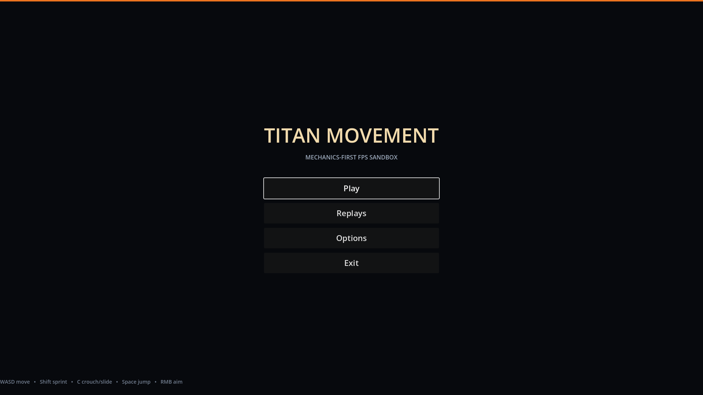
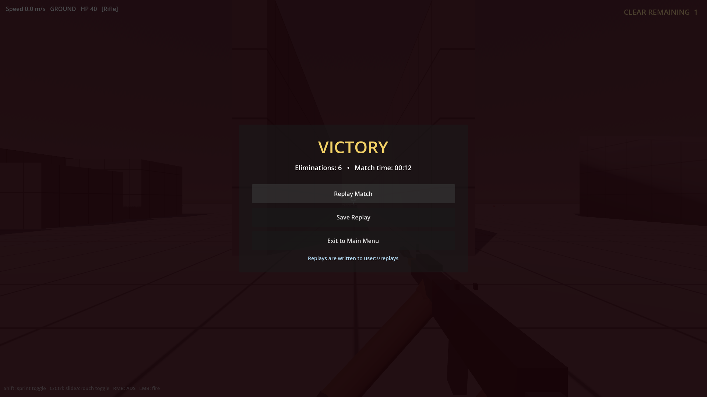
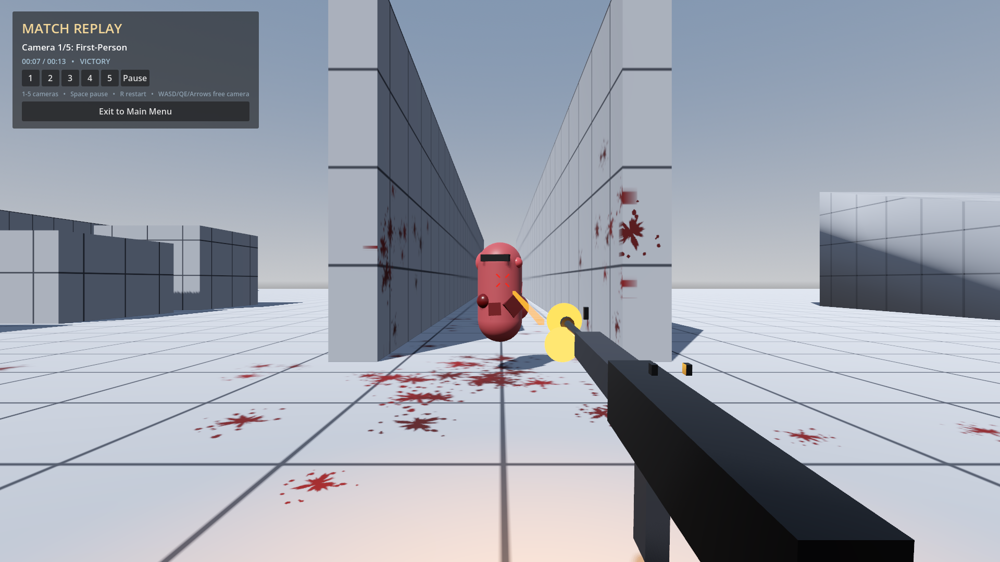

# Titan Movement FPS (Godot 4)

A greybox, mechanics-first Titanfall-inspired FPS. Everything is procedural
(primitive meshes, generated blood splats) so the movement, gunplay, AI and gore
loops can be tuned before the art pass.

Open `project.godot` in Godot 4.7+ (Forward+) and press **F5**. The main menu is
the startup scene.


## Main menu and match loop



- Main menu (`scenes/main_menu.tscn`): **Play**, **Replays**, **Options**, and
  **Exit**, wired to real scene transitions / quit. Options stores mouse
  sensitivity and master volume in `user://settings.cfg`.
- Matches use a fixed six-enemy roster spawned once at match start; the spawn
  timer is stopped immediately, so no new enemies appear mid-fight. Clearing all
  six triggers **Victory**; player death triggers **Defeat**. Both stop the
  spawner and emit arena signals.
- The post-match CanvasLayer offers **Replay Match**, **Save Replay**, and
  **Exit to Main Menu**. Saved replays are written as JSON under
  `user://replays/`; the Replays menu lists and opens them.
- The arena records player/enemy `global_transform` plus yaw, pitch, health,
  ADS/sprint state and camera FOV at a fixed 20 Hz into ReplayManager, along with
  shot, hit and death events.



## Replay viewer

Open the viewer from the post-match **Replay Match** button or from **Replays**
on the main menu. Playback interpolates the recorded transforms and replays
recorded events.

Replay fidelity includes:
- First-person rifle viewmodel with hip/ADS/sprint poses, shot recoil and muzzle
  flash.
- Recorded shot tracers, impact hitmarkers, and enemy death gore (blood
  explosion, gibs, decals).
- Spatial 3D audio for gunshots, impacts and deaths; volume/panning follows the
  replay camera's distance from the recorded event.
- The live arena's exact shared level geometry (`scripts/arena_level.gd`),
  including the slide ramp, platforms, pillars and collision, is instantiated in
  the replay rather than a reduced proxy map.



| Key | Camera / Action |
|---|---|
| **1** | First-person — camera attached to the recorded player head |
| **2** | Third-person — SpringArm3D following the player |
| **3** | Drone — smooth lerped follow camera |
| **4** | Free camera — WASD, Q/E, arrow keys, Shift for speed |
| **5** | Static area cameras — cycles fixed cameras that `look_at()` the player |
| **Space** | Pause / resume |
| **R** | Restart replay |
| **Esc** | Exit to main menu |

## Controls

| Input | Action |
|---|---|
| **WASD** | Move |
| **Shift** | **Toggle sprint** (off by default). Pressing it while crouched/sliding instantly cancels the crouch and transitions to sprint. Sprint switches off the moment the movement keys are released. |
| **C / Ctrl** | **Toggle crouch**; if you are moving fast it becomes a **slide**. Press again to stand/end the slide. |
| **Space** | Jump / double jump / wall jump. Hold on the ground to auto-hop. |
| **Mouse** | Look |
| **LMB** | Fire the equipped gun / throw a grenade / place C4 |
| **RMB (hold)** | Aim down sights — zooms the camera, tightens spread, and the sights align (the sniper opens a scope overlay). With C4 equipped, **RMB detonates** placed charges. |
| **R** | Reload (also starts automatically when you fire an empty magazine) |
| **1 / 3 / 4** | CS 1.6-style weapon slots: **1** sidearms (Pistol, SMG), **3** primary (Rifle, Sniper), **4** ordnance (Frag Grenade, C4). Pressing a slot again cycles the weapons you own in it. |
| **F** | Toggle bullet time (0.35× global time scale). |
| **Esc** | **Pause menu** — Resume, Restart Game, Return to Main Menu, Quit Game |

## Implemented mechanics

### Movement
- Source-style ground acceleration and air-strafing, coyote time, auto-hop.
- Toggle sprint, toggle crouch, slide with slope boost and slide-hop.
- Wall-run (camera roll + reduced gravity), wall-jump with air wall-jump budget,
  double jump, speed-sensitive FOV.
- Crouch/slide is a **toggle**, not hold. Sprint overrides crouch immediately.

### Rifle and projectiles
- Placeholder automatic rifle with iron sights, muzzle, magazine and arms.
- Shots are **real travelling projectiles** (`scripts/projectile.gd`) spawned at
  the muzzle with a finite velocity (165 m/s). Each physics tick advances the
  bullet and sweeps a ray from its previous to its new position, so it can
  actually miss moving targets and cannot tunnel through thin geometry.
- The projectile is aimed at the point under the projected reticle (plus the
  current spread sample). Damage is applied on physical impact, not instantly
  on the trigger pull.
- ADS zooms the camera (~3.5x), tightens spread, slows movement and aligns the
  iron sights on the aim point.

### Weapons, ammo and reload
- Weapon data lives in `scripts/weapon_defs.gd` (damage, rate, magazine, projectile
  speed, spread, zoom, reload time); viewmodels are built from primitives in
  `scripts/weapon_models.gd`. Every gun fires the same physical projectile.

| Slot | Key | Weapons |
|---|---|---|
| 1 | `1` | Pistol (semi-auto), SMG (full-auto) |
| 2 | `3` | Rifle (full-auto), Sniper (scoped, 110 damage, slow bolt rate) |
| 3 | `4` | Frag Grenade (2.5 s fuse, area damage), C4 (place up to 3, RMB to detonate) |

- Ammo is limited: a magazine plus a per-ammo-type reserve (light / rifle / sniper).
  Reloading plays a multi-phase viewmodel animation (mag out, mag in, bolt/slide)
  with procedural sounds (`scripts/proc_audio.gd`).
- Explosives deal falloff damage in a radius, hurt the player too, and kick the camera
  (`scripts/explosion.gd`, `grenade.gd`, `c4_charge.gd`).

### HUD, pause menu and loot
- `scripts/game_hud.gd`: health bar (current / max, colour shifts as it drops, low-health
  pulse), ammo counter (magazine / reserve), weapon slot list, pickup toasts and the
  sniper scope.
- `scripts/pause_menu.gd`: Esc toggles `SceneTree.paused`; Restart / Main Menu / Quit.
  It disables itself when the match ends so the results screen owns Esc.
- `scripts/loot_table.gd` + `pickup.gd`: enemies drop randomized loot (ammo, medkits,
  weapons, grenades, C4). Weights adapt to need — low ammo favours ammo, low health
  favours medkits, unowned weapons are favoured. Tune the constants at the top of the file.

### Cover-based enemy AI
- `scripts/enemy.gd` is a state machine: **ADVANCE → TO_COVER → HOLD → PEEK**, then
  relocates after a few peeks or when hurt while exposed. Enemies never rush into
  melee; with no cover available they close to a comfortable range and shoot.
- `scripts/cover_manager.gd` knows the cover spots generated by the level
  (`arena_level.gd`), verifies each with a real ray-cast (is the spot really hidden from the
  player right now?), checks the navmesh for reachability, finds peek positions, and
  lets only one enemy claim a spot. Low cover makes the enemy crouch.
- Enemies shoot with the **same projectile** as the player (red tracers). Accuracy is
  adjustable per enemy via the exported **Accuracy** group: `spread_scale` (difficulty
  knob), `aim_spread_deg`, `spread_per_shot_deg`, `max_spread_deg`, `moving_spread_deg`,
  `aim_error_deg` and `reaction_time`. Enemy shots are recorded and shown in replays.

### Tests
Headless integration tests (Godot 4.7):

```
godot --headless --path . --fixed-fps 60 --scene res://tests/smoke_test.tscn
godot --headless --path . --fixed-fps 60 --scene res://tests/replay_test.tscn
```

### Dynamic reticle / recoil
- Circular reticle (`scripts/reticle.gd`) whose radius is computed from the
  weapon's live angular spread in pixels.
- **Bloom**: every shot expands the spread and the ring; it decays after firing
  and is capped at a maximum.
- **Hip-fire UI recoil**: each shot kicks the reticle upward (primary) with
  random horizontal jitter, then springs back. The camera is not kicked.
  The ring's screen-space offset is projected into the world, so the rifle and
  the bullets follow exactly where the reticle is drawn.
- **ADS recoil**: reticle movement is disabled, the reticle fades out, and the
  recoil force is applied directly to the camera instead.
- Spread also reflects movement speed, sprinting, being airborne, and ADS.

### Procedural weapon aim and arm IK
- The rifle pivot is rotated every frame so its bore points exactly at the world
  point projected under the reticle (`get_aim_point()`).
- Both arms are attached with an analytic **two-bone IK** solve to the pistol
  grip and handguard, so they follow the rifle through hip, ADS and sprint
  poses.
- Firing from the hip while sprinting overrides the cross-body sprint pose and
  snaps the rifle forward toward the reticle.

### Enemies, navigation and gore
- `NavigationAgent3D` pathfinding on a runtime-baked navmesh. Enemies path
  around walls/pillars and pick flanking points instead of walking straight at
  the player.
- RVO avoidance plus a small explicit separation push and physical collision
  prevent enemies from stacking on the same spot.
- Enemies flash red on hit, and explode on death into rigid-body flesh chunks,
  blood particle sprays, directional blood mist and procedural blood decals.
- Hitmarkers: small diagonal ticks drawn at the **exact screen position of the
  projectile impact**, not the centre of the screen. Normal hits use
  `assets/sounds/hitmarker-sound-effect.wav`; kill ticks are red and silent so
  the spatial blood-impact sound takes priority. See `screenshots/hitmarker.png`.

### Audio
- Rifle fire uses `assets/sounds/semiautorifleshot.wav` through a 3-voice pool
  with slight random pitch and volume variation per shot.
- Enemy deaths play the spatial `assets/sounds/blood_impact_.wav` at the death
  position with a slight random pitch shift. There is no hitmarker kill sound
  underneath it.

## File map

| File | Purpose |
|---|---|
| `scripts/player.gd` | Movement states, toggles, camera, HUD, damage |
| `scripts/weapon.gd` | Rifle model, fire control, bloom, procedural aim/IK |
| `scripts/projectile.gd` | Travelling bullet with swept collision and impact FX |
| `scripts/reticle.gd` | Dynamic spread ring + UI recoil |
| `scripts/hitmarker.gd` | Impact-position hitmarker + hit sound |
| `scripts/replay_manager.gd` | Autoload: recording, JSON save/load, replay list |
| `scripts/replay_viewer.gd` | Recorded ghost playback + five camera modes |
| `scripts/arena_level.gd` | Shared static map, ramp, lighting and colliders |
| `scripts/main_menu.gd` | Main menu scene transitions |
| `scripts/options.gd` | Sensitivity / volume settings |
| `scripts/replay_browser.gd` | Saved replay list and launcher |
| `scripts/enemy.gd` | NavAgent rusher, avoidance/separation, death |
| `scripts/gore.gd` | Autoload gore manager (gibs, spray, decals) |
| `scripts/gib.gd` | Rigid-body flesh chunk with blood trail |
| `scripts/arena.gd` | Level, navmesh, spawner, match flow and recording |
| `scenes/main_menu.tscn` | Main menu UI |
| `scenes/main.tscn` | Gameplay scene root (arena script builds the level) |

## Tuning notes

- Weapon feel: exports under `Weapon` (fire rate, projectile speed, bloom,
  spread, recoil) and `Player` (speeds, jump, wall-run, slide).
- Reticle scale is derived from `camera.fov`, so it stays visually correct when
  the ADS zoom changes.
- Renderer must be Forward+ or Mobile for `Decal` blood splats; Compatibility
  will not render them.
- All art is placeholder. The next pass can replace the primitive rifle, arms,
  enemy mesh and gore meshes without touching the mechanics scripts.
